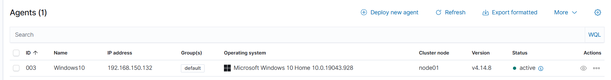
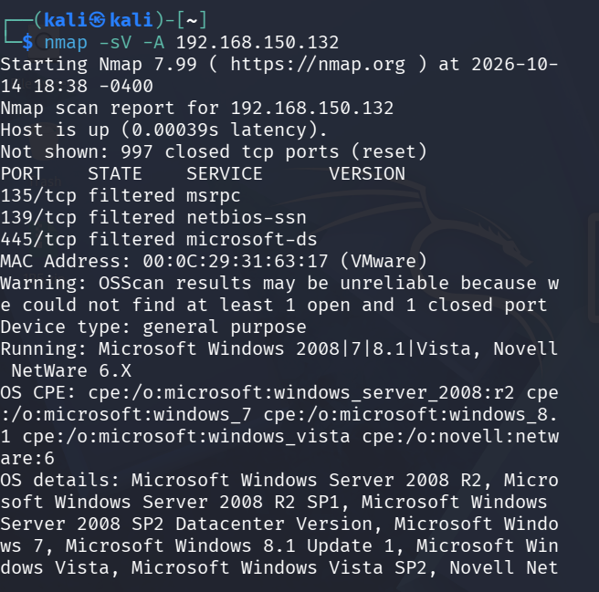
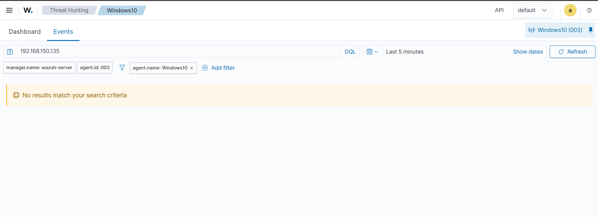

# Network Service Scanning & Wazuh Detection Gap

Empirical detection testing of unauthenticated port scanning and reconnaissance against a Wazuh-monitored Windows endpoint.

---

## Overview

| Parameter | Details |
|---|---|
| **Objective** | Determine if default Wazuh configuration detects basic network reconnaissance (Nmap scan) |
| **MITRE ATT&CK** | [T1046 — Network Service Scanning](https://attack.mitre.org/techniques/T1046/) |
| **Attacking Host** | Kali Linux (`192.168.150.135`) |
| **Target Host** | Windows 10 Home (`192.168.150.132`, Wazuh Agent ID `003`, v4.14.8) |
| **SIEM Platform** | Wazuh Manager (`wazuh-server`, cluster node `node01`) |
| **Test Result** | **Detection Gap** (Zero alerts generated out of the box) |

---

## Environment Setup

The target endpoint runs an active Wazuh agent enrolled with the central manager:



- **Agent ID:** `003`
- **Agent Name:** `Windows10`
- **IP Address:** `192.168.150.132`
- **Operating System:** Microsoft Windows 10 Home 10.0.19043.928
- **Status:** Active

---

## Adversary Simulation (Attack)

From the Kali Linux machine, executed a service version scan and aggressive OS detection probe against the Windows target:

```bash
nmap -sV -A 192.168.150.132
```



### Scan Results
- 997 closed ports reset.
- Filtered ports identified: `135/tcp` (msrpc), `139/tcp` (netbios-ssn), `445/tcp` (microsoft-ds).
- OS fingerprinting initiated probes against TCP/IP stack behavior.

---

## SIEM Detection Query

In the Wazuh dashboard under **Threat Hunting / Security Events**, queried events on the Windows 10 agent during the attack time window:

- **Filter:** `manager.name: wazuh-server` AND `agent.id: 003` AND `agent.name: Windows10`
- **Search Query:** `192.168.150.135` (Kali IP)
- **Time Window:** Last 5 minutes



**Result:** Zero matching alerts found (`No results match your search criteria`).

---

## Root Cause Analysis

1. **Default Rule Limitations:** The default Wazuh ruleset relies on Windows Event Logs (Security, System, Application). Unauthenticated TCP port scans (SYN/CONNECT) do not generate standard Windows logon or audit failure events.
2. **Firewall Logging Inactive:** Windows Defender Firewall packet-drop logging is disabled by default. Dropped or rejected probe packets never write to a log file.
3. **Log Ingestion Gap:** Without active firewall logging or Sysmon network connection logging (Event ID 3), network-layer probe traffic remains entirely invisible to the Wazuh agent and manager.

---

## Outcome & Remediation Roadmap

This confirms a **detection gap** for MITRE ATT&CK T1046 out of the box.

### Remediation Steps
1. **Enable Windows Firewall Logging:**
   - Configure Windows Firewall to log dropped packets and successful connections to `%SystemRoot%\System32\LogFiles\Firewall\pfirewall.log`.
2. **Configure Wazuh Agent Ingestion:**
   - Add `<localfile>` monitoring in `ossec.conf` targeting `pfirewall.log` using the `windows-firewall` log format.
3. **Deploy Custom Detection Rule:**
   - Write a custom Wazuh rule with a frequency threshold (e.g., >10 dropped connection attempts from a single source IP within 10 seconds) to alert on port scanning activity.

---

_Back to [SOC Homelab Dashboard](../README.md)_
