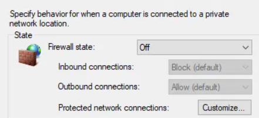
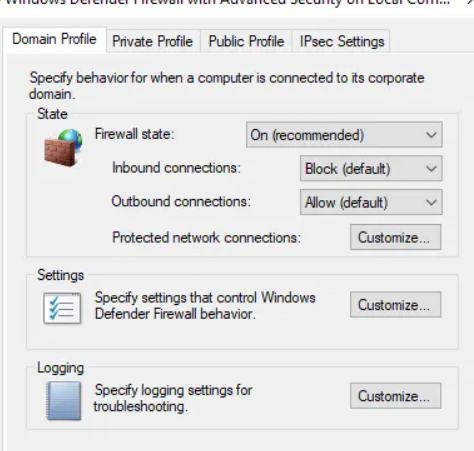
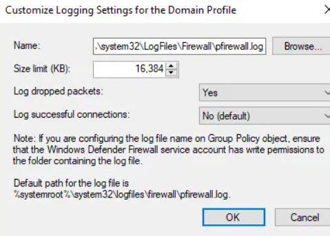
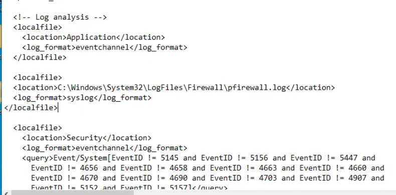
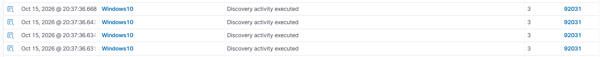

# Network Service Scanning & Wazuh Detection Gap

Empirical detection testing of unauthenticated port scanning and reconnaissance against a Wazuh-monitored Windows endpoint, identifying the telemetry gap and implementing full firewall-to-SIEM remediation.

---

## Overview

| Parameter | Details |
|---|---|
| **Objective** | Determine if default Wazuh configuration detects basic network reconnaissance (Nmap scan) |
| **MITRE ATT&CK** | [T1046 — Network Service Scanning](https://attack.mitre.org/techniques/T1046/) |
| **Attacking Host** | Kali Linux (`192.168.150.135`) |
| **Target Host** | Windows 10 Home (`192.168.150.132`, Wazuh Agent ID `003`, v4.14.8) |
| **SIEM Platform** | Wazuh Manager (`wazuh-server`, cluster node `node01`) |
| **Initial Result** | **Detection Gap** (Zero alerts generated out of the box) |
| **Final Result** | **Detection Gap Closed** (Rule `92031` — *Discovery activity executed* successfully triggered) |

---

## Environment Setup

The target endpoint runs an active Wazuh agent enrolled with the central manager:


- **Agent ID:** `003`
- **Agent Name:** `Windows10`
- **IP Address:** `192.168.150.132`
- **Operating System:** Microsoft Windows 10 Home 10.0.19043.928
- **Status:** Active

---

## Initial Adversary Simulation (Attack)

From the Kali Linux machine, executed a service version scan and aggressive OS detection probe against the Windows target:

```bash
nmap -sV -A 192.168.150.132
```


### Scan Results
- 997 closed ports reset.
- Filtered ports identified: `135/tcp` (msrpc), `139/tcp` (netbios-ssn), `445/tcp` (microsoft-ds).
- OS fingerprinting initiated probes against TCP/IP stack behavior.

---

## Initial SIEM Detection Query (Detection Gap)

In the Wazuh dashboard under **Threat Hunting / Security Events**, queried events on the Windows 10 agent during the attack time window:

- **Filter:** `manager.name: wazuh-server` AND `agent.id: 003` AND `agent.name: Windows10`
- **Search Query:** `192.168.150.135` (Kali IP)
- **Time Window:** Last 5 minutes


**Result:** Zero matching alerts found (`No results match your search criteria`).

---

## Root Cause Analysis: Why It Didn't Work Before

Investigation revealed two critical telemetry gaps preventing Wazuh from seeing the network probe:

1. **Firewall Was Turned Off:** On the Windows 10 target, the Windows Defender Firewall state was set to **Off**:
   
   
   
   Because the firewall was disabled, inbound probe packets were handled directly by the operating system network stack without undergoing filtering or drop inspection.

2. **No Firewall Telemetry Logging:** Even if ports were closed/filtered, Windows Firewall logging is disabled by default. Dropped connection attempts never generated log files on disk.

3. **Missing SIEM Log Ingestion Channel:** By default, Wazuh agents monitor Windows Event Channels (Application, Security, System). Raw network packet drops are not part of standard security event IDs unless explicitly ingested from firewall logs or Sysmon.

---

## Remediation Implemented

To bridge the detection gap, end-to-end logging was configured and forwarded to Wazuh:

### Step 1: Enable Windows Defender Firewall

Turned on the firewall for Domain and Private network profiles with default inbound block policy:



- **Firewall state:** `On (recommended)`
- **Inbound connections:** `Block (default)`
- **Outbound connections:** `Allow (default)`

### Step 2: Enable Dropped Packet Logging

Configured advanced logging settings to capture all blocked network connection attempts:



- **Log File Location:** `%systemroot%\system32\logfiles\firewall\pfirewall.log`
- **Size limit (KB):** `16,384`
- **Log dropped packets:** `Yes`
- **Log successful connections:** `No (default)`

### Step 3: Configure Wazuh Agent Log Ingestion (`ossec.conf`)

Added a dedicated `<localfile>` block inside `C:\Program Files (x86)\ossec-agent\ossec.conf` on the Windows 10 endpoint to ingest the firewall drop log using syslog format:



```xml
<!-- Windows Firewall Log Analysis -->
<localfile>
  <location>C:\Windows\System32\LogFiles\Firewall\pfirewall.log</location>
  <log_format>syslog</log_format>
</localfile>
```

Restarted the Wazuh Agent service to apply the new telemetry configuration:

```powershell
Restart-Service -Name "Wazuh"
```

---

## Verification & Detection Validation

With firewall logging and Wazuh ingestion active, re-executed the Nmap scan from Kali Linux (`192.168.150.135`).

### Wazuh Security Events Dashboard

Wazuh immediately parsed the firewall drop stream, correlated the scan pattern, and generated multiple timestamped alerts:



| Timestamp | Agent | Alert Description | Level | Rule ID |
|---|---|---|:---:|:---:|
| `Oct 15, 2026 @ 20:37:36.668` | `Windows10` | **Discovery activity executed** | `3` | `92031` |
| `Oct 15, 2026 @ 20:37:36.643` | `Windows10` | **Discovery activity executed** | `3` | `92031` |
| `Oct 15, 2026 @ 20:37:36.634` | `Windows10` | **Discovery activity executed** | `3` | `92031` |
| `Oct 15, 2026 @ 20:37:36.631` | `Windows10` | **Discovery activity executed** | `3` | `92031` |

### Key Takeaway
- **Detection Gap Closed:** By enabling Windows Firewall packet-drop telemetry and piping `pfirewall.log` into Wazuh via `syslog` log format, unauthenticated network reconnaissance (T1046) is now reliably detected and indexed in real-time.

---

_Back to [SOC Homelab Dashboard](../README.md)_
