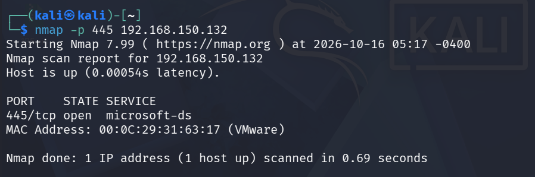
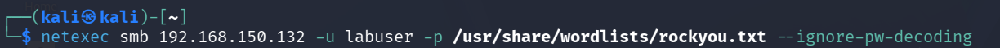
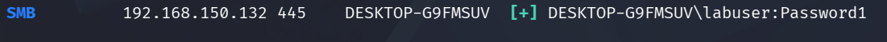
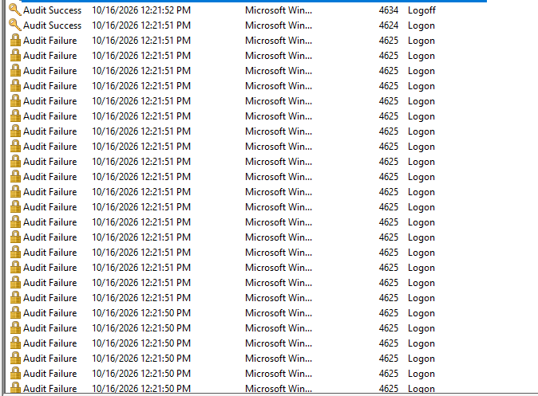
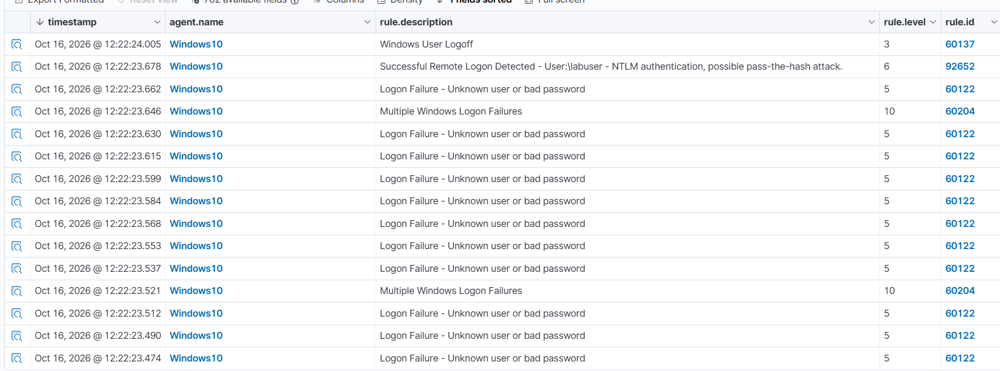

# SMB Brute Force & Credential Access Detection

Adversary emulation of an SMB password brute-force attack using NetExec and dictionary matching, analyzing Windows security telemetry (Event IDs 4625 and 4624), and validating automated SIEM correlation rules in Wazuh.

---

## Overview

| Parameter | Details |
|---|---|
| **Objective** | Execute an SMB dictionary brute-force attack, capture endpoint authentication telemetry, and validate Wazuh multi-event correlation |
| **MITRE ATT&CK** | [T1110.001 — Password Guessing](https://attack.mitre.org/techniques/T1110/001/) & [T1110.003 — Password Spraying](https://attack.mitre.org/techniques/T1110/003/) |
| **Attacking Host** | Kali Linux (`192.168.150.135`) |
| **Target Host** | Windows 10 (`192.168.150.132`, Hostname: `DESKTOP-G9FMSUV`, Agent ID: `003`) |
| **SIEM Platform** | Wazuh Manager (`wazuh-server`) |
| **Attack Tools** | Nmap, NetExec (`nxc`), `rockyou.txt` wordlist |
| **Detection Result** | **Successful Alerting** — Individual failures (Rule `60122`), High-severity brute-force correlation (Rule `60204`, Level 10), and post-compromise logon (Rule `92652`) |

---

## Phase 1: Service Enumeration

From Kali Linux, verified that SMB service (port 445) was open and accessible on the Windows 10 target:

```bash
nmap -p 445 192.168.150.132
```



- **Port State:** `445/tcp open microsoft-ds`
- Confirmed SMB endpoint availability for authentication testing.

---

## Phase 2: Adversary Simulation (NetExec Brute Force)

Utilized **NetExec** to launch a dictionary attack against target user `labuser` across SMB using the standard `rockyou.txt` wordlist:

```bash
netexec smb 192.168.150.132 -u labuser -p /usr/share/wordlists/rockyou.txt --ignore-pw-decoding
```



### Attack Result
NetExec tested passwords sequentially until identifying valid credentials:



```text
SMB    192.168.150.132 445    DESKTOP-G9FMSUV    [+] DESKTOP-G9FMSUV\labuser:Password1
```

- **Cracked Credentials:** `DESKTOP-G9FMSUV\labuser` : `Password1`
- Target authenticated successfully over SMB via NTLM.

---

## Phase 3: Endpoint Telemetry (Windows Event Logs)

Inspecting the **Security** event log on the target Windows 10 workstation (`DESKTOP-G9FMSUV`) revealed immediate, dense authentication telemetry:



- **Event ID 4625 (Logon Failure):** Generated rapidly in bursts for each incorrect candidate password from `rockyou.txt`.
- **Event ID 4624 (Successful Logon):** Generated at `12:21:51 PM` when the correct password (`Password1`) was submitted (Logon Type 3 — Network Logon).
- **Event ID 4634 (Logoff):** Generated at `12:21:52 PM` following session teardown by NetExec.

---

## Phase 4: SIEM Detection & Rule Correlation (Wazuh)

In the Wazuh dashboard under **Security Events**, the attack generated high-fidelity alerts illustrating the progression from brute-force attempts to successful unauthorized access:



### Correlated Rule Breakdown

| Timestamp | Rule ID | Level | Rule Description | Significance |
|---|:---:|:---:|---|---|
| `12:22:23.474 - .662` | **`60122`** | `5` | `Logon Failure - Unknown user or bad password` | Individual Event ID 4625 detections. |
| `12:22:23.521` | **`60204`** | `10` | `Multiple Windows Logon Failures` | **Composite Correlation Rule:** Triggered when repeated logon failures occur from the same source within a short time threshold. |
| `12:22:23.646` | **`60204`** | `10` | `Multiple Windows Logon Failures` | Continued correlation alert as attempts exceeded subsequent thresholds. |
| `12:22:23.678` | **`92652`** | `6` | `Successful Remote Logon Detected - User:\labuser - NTLM authentication, possible pass-the-hash attack.` | **Compromise Alert:** Flags successful NTLM network logon (Event ID 4624) directly following the brute-force sequence. |
| `12:22:24.005` | **`60137`** | `3` | `Windows User Logoff` | Event ID 4634 session termination. |

---

## SOC Takeaways & Defensive Recommendations

1. **Detection Effectiveness:** Unlike unauthenticated port scanning (which required explicit firewall logging), Windows generates built-in **Event ID 4625** for all failed authentication attempts. Wazuh's default Windows ruleset successfully ingested, parsed, and correlated these events to fire high-severity **Level 10** alerts (`Rule 60204`).
2. **Account Lockout Policy:** Deploy an account lockout threshold (e.g., lock account after 5 failed attempts within a 15-minute window) via Local Security Policy or Group Policy (`net accounts /lockoutthreshold:5`) to mitigate online dictionary attacks.
3. **Network Boundary Defenses:** Restrict SMB (TCP 445) exposure to required administrative subnets or bastion hosts using Windows Defender Firewall rules.
4. **Strong Password Complexity:** Enforce passphrases that resist common dictionary attacks (`rockyou.txt`).

---

_Back to [SOC Homelab Dashboard](../README.md)_
