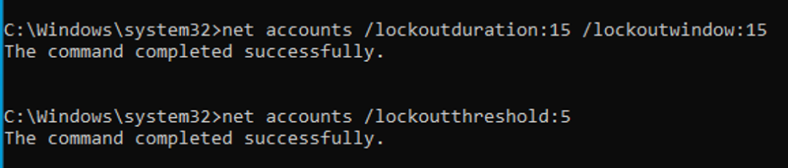
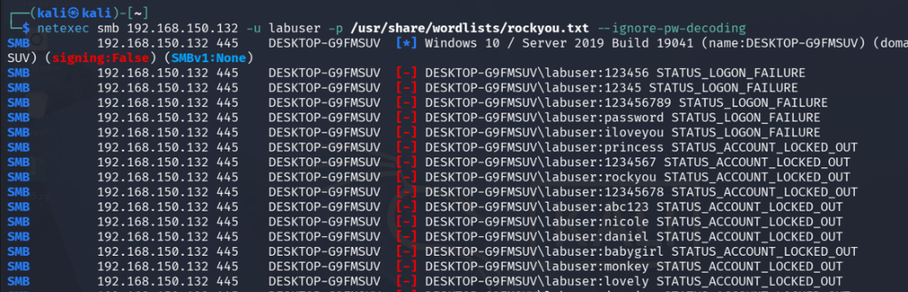
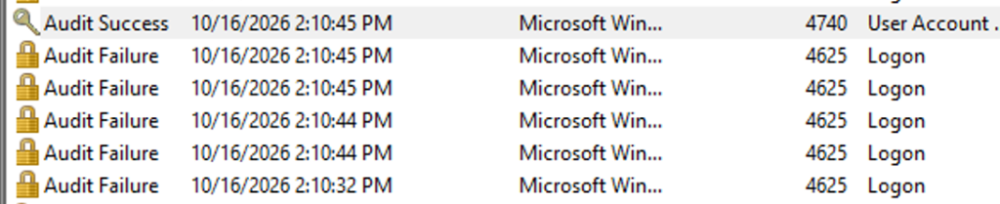

# SMB Brute Force & Credential Access Detection

Adversary emulation of an SMB password brute-force attack using NetExec and dictionary matching, analyzing Windows security telemetry (Event IDs 4625 and 4624), and validating automated SIEM correlation rules in Wazuh.

---

## Overview

| Parameter | Details |
|---|---|
| **Objective** | Execute an SMB dictionary brute-force attack, capture endpoint authentication telemetry, and validate Wazuh multi-event correlation |
| **MITRE ATT&CK** | [T1110.001 — Password Guessing](https://attack.mitre.org/techniques/T1110/001/) & [T1110.003 — Password Spraying](https://attack.mitre.org/techniques/T1110/003/) |
| **Attacking Host** | Kali Linux (`192.168.150.135`) |
| **Target Host** | Windows 10 (`192.168.150.132`, Hostname: `DESKTOP-G9FMSUV`, Agent ID: `003`) |
| **SIEM Platform** | Wazuh Manager (`wazuh-server`) |
| **Attack Tools** | Nmap, NetExec (`nxc`), `rockyou.txt` wordlist |
| **Detection Result** | **Successful Alerting** — Individual failures (Rule `60122`), High-severity brute-force correlation (Rule `60204`, Level 10), and post-compromise logon (Rule `92652`) |

---

## Phase 1: Service Enumeration

From Kali Linux, verified that SMB service (port 445) was open and accessible on the Windows 10 target:

```bash
nmap -p 445 192.168.150.132
```


- **Port State:** `445/tcp open microsoft-ds`
- Confirmed SMB endpoint availability for authentication testing.

---

## Phase 2: Adversary Simulation (NetExec Brute Force)

Utilized **NetExec** to launch a dictionary attack against target user `labuser` across SMB using the standard `rockyou.txt` wordlist:

```bash
netexec smb 192.168.150.132 -u labuser -p /usr/share/wordlists/rockyou.txt --ignore-pw-decoding
```


### Attack Result
NetExec tested passwords sequentially until identifying valid credentials:


```text
SMB    192.168.150.132 445    DESKTOP-G9FMSUV    [+] DESKTOP-G9FMSUV\labuser:Password1
```

- **Cracked Credentials:** `DESKTOP-G9FMSUV\labuser` : `Password1`
- Target authenticated successfully over SMB via NTLM.

---

## Phase 3: Endpoint Telemetry (Windows Event Logs)

Inspecting the **Security** event log on the target Windows 10 workstation (`DESKTOP-G9FMSUV`) revealed immediate, dense authentication telemetry:


- **Event ID 4625 (Logon Failure):** Generated rapidly in bursts for each incorrect candidate password from `rockyou.txt`.
- **Event ID 4624 (Successful Logon):** Generated at `12:21:51 PM` when the correct password (`Password1`) was submitted (Logon Type 3 — Network Logon).
- **Event ID 4634 (Logoff):** Generated at `12:21:52 PM` following session teardown by NetExec.

---

## Phase 4: SIEM Detection & Rule Correlation (Wazuh)

In the Wazuh dashboard under **Security Events**, the attack generated high-fidelity alerts illustrating the progression from brute-force attempts to successful unauthorized access:


### Correlated Rule Breakdown

| Timestamp | Rule ID | Level | Rule Description | Significance |
|---|:---:|:---:|---|---|
| `12:22:23.474 - .662` | **`60122`** | `5` | `Logon Failure - Unknown user or bad password` | Individual Event ID 4625 detections. |
| `12:22:23.521` | **`60204`** | `10` | `Multiple Windows Logon Failures` | **Composite Correlation Rule:** Triggered when repeated logon failures occur from the same source within a short time threshold. |
| `12:22:23.646` | **`60204`** | `10` | `Multiple Windows Logon Failures` | Continued correlation alert as attempts exceeded subsequent thresholds. |
| `12:22:23.678` | **`92652`** | `6` | `Successful Remote Logon Detected - User:\labuser - NTLM authentication, possible pass-the-hash attack.` | **Compromise Alert:** Flags successful NTLM network logon (Event ID 4624) directly following the brute-force sequence. |
| `12:22:24.005` | **`60137`** | `3` | `Windows User Logoff` | Event ID 4634 session termination. |

---

## Phase 5: Defensive Remediation — Account Lockout Policy (The Fix)

### The Vulnerability
During the initial attack, the target Windows system permitted unlimited consecutive failed logon attempts, enabling the adversary to exhaust dictionary candidates until successfully recovering `Password1`.

### Implementing the Lockout Policy
To stop brute-force and password-spraying attacks, configured an Account Lockout Policy on the Windows 10 target via the administrative command prompt:

```cmd
net accounts /lockoutduration:15 /lockoutwindow:15
net accounts /lockoutthreshold:5
```



- **Lockout Threshold:** 5 invalid logon attempts triggers an immediate account lockout.
- **Lockout Duration:** 15 minutes before the account unlocks automatically.
- **Lockout Observation Window:** 15 minutes between failed attempt counter resets.

---

## Phase 6: Adversary Re-Test & Security Telemetry

### Attack Mitigation Proof (NetExec)
Re-executed the exact same dictionary attack from Kali Linux:

```bash
netexec smb 192.168.150.132 -u labuser -p /usr/share/wordlists/rockyou.txt --ignore-pw-decoding
```



- Attempts 1–5 (`123456`, `12345`, `123456789`, `password`, `iloveyou`) failed with `STATUS_LOGON_FAILURE`.
- Upon the 6th attempt (`princess`), Windows enforced the threshold and denied access with:
  ```text
  [-] DESKTOP-G9FMSUV\labuser:princess STATUS_ACCOUNT_LOCKED_OUT
  ```
- All subsequent dictionary candidates were rejected immediately with `STATUS_ACCOUNT_LOCKED_OUT`, successfully neutralizing the attack before valid credentials could be discovered.

### Security Log Telemetry (Event ID 4740)
Inspected the Windows Security event log on `DESKTOP-G9FMSUV` to verify telemetry generation:



- **Event ID 4625 (Logon Failure):** Logged for each of the initial 5 invalid attempts between `2:10:32 PM` and `2:10:45 PM`.
- **Event ID 4740 (User Account Locked Out):** Logged at `2:10:45 PM` as an **Audit Success** event immediately upon crossing the 5-attempt threshold.

---

## SOC Takeaways & Defense Summary

1. **Defense-in-Depth:** While Wazuh successfully detects brute-force activity via **Rule 60204 (Level 10)**, detection alone does not stop credential compromise. Coupling SIEM detection with an active **Account Lockout Policy** terminates the attack vector in real-time.
2. **Audit Telemetry:** The lockout event generates **Event ID 4740**, providing high-confidence incident response evidence of active credential abuse.
3. **Operational Hardening:** Enforce account lockouts (`net accounts /lockoutthreshold:5`), restrict SMB boundary exposure, and mandate multi-factor authentication across all network logon interfaces.

---

_Back to [SOC Homelab Dashboard](../README.md)_
